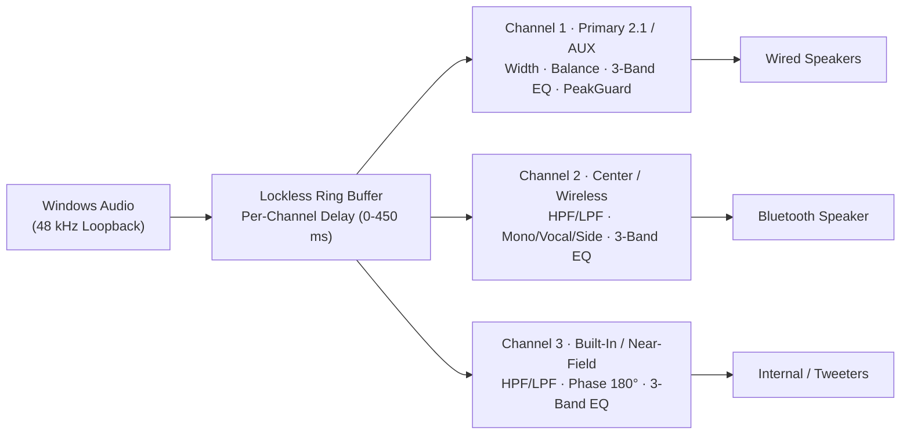

<div align="center">

# PhaseMiX

**Sync wired, Bluetooth, and built-in speakers into one phase-aligned Windows soundstage.**


</div>

---

## Signal Flow



---

## Core Modules

| Feature | What It Does | Specs |
| :--- | :--- | :--- |
| **Phase & Delay Sync** | Delays fast wired/internal speakers to match Bluetooth lag | `0 – 450 ms`, `±2 ms` fine step, drift resampling |
| **3-Band EQ + Crossover** | Sculpt lows, vocals & highs independently per output | `110 Hz` shelf · `1 kHz` bell · `4.5 kHz` shelf (`±12 dB`), `HPF`/`LPF` |
| **Ear-Safe Protection** | Prevents sudden system volume blasts or clipping | Master cap (`15–200%`), C¹ soft-knee limiter (`-30` to `-0.5 dB`) |
| **Position Presets** | Instant stage layouts synced with live 3D room visualizer | `Desk Triangle`, `Cinema 3.2`, `Wide Room`, `Night Safe`, `Offset`, `Flat` |
| **Windows Integration** | Keyboard Volume/Mute bridge + per-endpoint level sync | Win32 `IAudioEndpointVolume` + virtual loopback unity lock |

---

## Position Presets

| Preset | Stage Strategy | Safety / Focus |
| :--- | :--- | :--- |
| **Desk Triangle** | Flanking L/R + `260 Hz+` vocal center + bright front air | Everyday balanced listening |
| **Cinema 3.2 Dialogue** | Widened L/R (`135%`) + `+3.5 dB` speech lock + side ambience | Movies & dialogue clarity |
| **Wide Room Music** | Boosted subs + full-mid center + sparkling tweeters | Full-room music punch |
| **Night Ear-Safe** | Tamed lows + soft vocal center | Strict `60%` cap & `-15 dB` limiter |
| **Offset Desk** | Compensates asymmetric L/R speaker placement (`+18` balance) | Off-center desks |
| **Pure Flat** | `0 dB` across all 9 bands | Direct stereo reference |

---

## Tech Stack

| Layer | Architecture | Details |
| :--- | :--- | :--- |
| **Desktop Shell & IPC** | Rust + Tauri v2 | Zero-HTTP IPC commands, `33 ms` live meter push, system tray, single-instance lock |
| **Audio Routing** | Native WASAPI (`wasapi` + `windows` crates) | Zero-alloc `SharedRing`, `8 ms` jitter deadband, `±1500 ppm` drift sync, BT auto-reconnect |
| **DSP Pipeline** | Pure Rust (`src-tauri/src/dsp.rs`) | Direct Form II transposed biquads, M/S width, C¹ soft-knee `PeakGuard` |
| **Frontend & 3D** | React 19 · TypeScript · Tailwind v4 · Three.js | Phosphor Icons, WebGL Aurora, 3D stage orbit view |

---

## Windows Installer & Desktop App

Run `PhaseMiX-Setup.exe` (NSIS, current-user install) for a standalone Edge WebView2 window with native tray controls, single-instance focus restore, and config stored in `%APPDATA%\PhaseMiX\config.json`.

To build the `.exe` installer from source:

```powershell
cd frontend
npm install && npm run build
npx tauri build --bundles nsis
```

---

## Quick Start (Dev Mode)

```powershell
cd frontend && npm install
npx tauri dev
```
