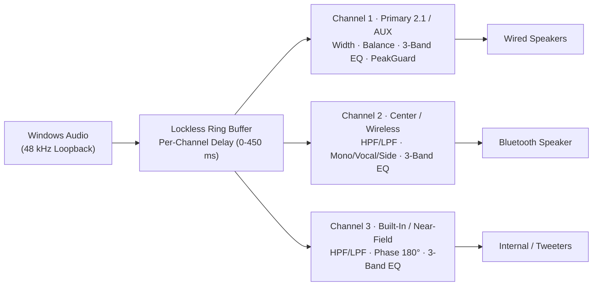

<div align="center">


# PhaseMiX

**Sync wired, Bluetooth, and built-in speakers into one phase-aligned Windows soundstage.**


</div>

---

## Signal Flow



---

## Core Modules

| Feature | What It Does | Specs |
| :--- | :--- | :--- |
| **Phase & Delay Sync** | Delays wired/internal speakers + 2-burst mic chirp align & link | `0 – 450 ms`, `±2 ms` step, Catmull-Rom drift sync, preserved across presets |
| **3-Band EQ + Live Curve** | Real-time 20 Hz–20 kHz curve, bass/mids/treble & crossovers per output | `110 Hz` · `1 kHz` · `4.5 kHz` (`±12 dB`), `HPF`/`LPF` |
| **Ear-Safe Protection** | Prevents sudden system volume blasts or clipping | Master cap (`15–200%`), hold-release PeakGuard (`-6 dB` / `-15 dB`) |
| **Interactive 3D Stage & Presets** | Width/balance/phase physics, click-to-solo, live laptop meters, compact mode | `Desk Triangle`, `Cinema 3.2`, `Wide Room`, `Night Safe`, Import/Export `.json` |
| **Windows Integration** | Perceptual Windows curve, saved per-speaker HW levels, 1 ms lock, hot-plug BT | `1–2%` media-key steps, `70 ms` BT / `35 ms` wired slack, `IAudioEndpointVolume` |

---

## Audio Routing Architecture

- **System Loopback Capture (`48 kHz` Stereo `f32`):** PhaseMiX captures a Windows render loopback endpoint (preferring virtual sinks such as **Steam Streaming Speakers**, **VB-Audio CABLE Input**, or **VoiceMeeter**, falling back to standard render loopback or physical inputs). Capture uses WASAPI `EventsShared` (`autoconvert: true`) with an **`80 ms`** Windows engine loopback buffer (`PollingShared` fallback in native mix format), while locking OS timer resolution to `1 ms` via `timeBeginPeriod(1)`.
- **Central `SharedRing` Buffer & Independent Workers:** Captured blocks write into a `4`-second (`192,000`-frame) ring pre-seeded by `600 ms` with a **`125 ms`** base playback cushion plus per-speaker delay (`0–450 ms`). Each of the 3 output slots spawns a dedicated `Pro Audio` thread opening WASAPI render streams (`70 ms` shared slack for detected wireless/BT names, `35 ms` wired) with non-blocking `try_write()` telemetry and monotonic underrun handling (never rewinds backwards over already-played audio).
- **Independent Clock-Drift Synchronization:** Separate audio hardware devices (Realtek DAC, USB/HDMI, Bluetooth A2DP) do not share a hardware clock crystal. Each output thread smooths ring-buffer offset with a `3.0 s` time-normalized EMA, ignores `< 1.5 ms` (`72`-frame) packet arrival jitter, and applies 4-point Catmull-Rom fractional resampling capped at **`±400 ppm`** (`±0.04%`) so speakers stay phase-aligned without audible pitch drift.
- **Volume Curves, Key Bridge & Persistent Device Levels:** DSP gains use a Windows-matched perceptual master curve (`x * 10^(-(1 - x))`) and smooth `x^1.5` speaker trims (`100–200%` linear boost), paired with a hold-release `PeakGuard` (`180 ms` hold, `450 ms` release). On virtual loopback inputs, `run_win_key_bridge` polls Windows `IAudioEndpointVolume` every `20 ms`, resets endpoint scalar to `0.98`, converts media-key presses into `1%` (`< 14%`) / `2%` (`>= 14%`) Master steps, and auto-restores per-device Windows volumes (`win_device_vols`) on startup and Bluetooth reconnect.

---

## Device Compatibility & Windows Setup

- **Virtual Audio Cable / Loopback Source (Recommended):** Set **Steam Streaming Speakers** or **VB-Audio CABLE Input** as the Windows **Default Playback Device** so desktop audio enters PhaseMiX cleanly without feeding back into your speakers. PhaseMiX warns if Windows switches default playback to a physical output.
- **Supported Output Devices:** Works with any active Windows WASAPI `Render` endpoint — **Realtek / analog `3.5 mm` speakers**, **built-in laptop speakers**, **USB DACs / USB headphones**, **HDMI/DisplayPort audio**, and **stereo Bluetooth (`A2DP`) speakers**.
- **Two Bluetooth Speakers Simultaneously:** Standard laptop Bluetooth adapters typically sustain only **one active `A2DP` stereo stream cleanly** at a time. To run two wireless speakers simultaneously, plug in a **USB Bluetooth Audio Transmitter dongle** (which Windows exposes as an independent `USB` sound device) alongside your laptop's built-in Bluetooth, unlink `AUX+PC`, and align both wireless delays manually using `Sync Click`.
- **Bluetooth Profile Tip:** PhaseMiX hides duplicate `Hands-Free / AG Audio` endpoints whenever stereo `Headphones` devices exist. Keep your default Windows microphone on your laptop/USB mic rather than a Bluetooth headset mic so voice apps do not force Bluetooth out of stereo `A2DP` into `16 kHz` mono Hands-Free mode.

---

## Latency Calibration Method

1. **Dual-Burst Acoustic Chirp Alignment (`Auto-Align Delay via Mic`):**
   - Requires routing running with both **Primary AUX** and **Center Wireless (BT)** assigned (and powered/unmuted at the speaker hardware) plus a working Windows default microphone.
   - After draining `160 ms` of cold mic audio, PhaseMiX injects **4 alternating `44 ms` Hann-windowed logarithmic chirps (`600 Hz -> 3.4 kHz`)** over `3.05 s` (`BT 1` at `+180 ms`, `AUX 1` at `+980 ms`, `BT 2` at `+1750 ms`, `AUX 2` at `+2550 ms`) with built-in laptop speakers muted during the sweep.
   - An analytic quadrature matched filter (`find_chirp_arrival`, SNR `>= 4.0` threshold and earliest-direct-path crest scan within `6 ms`) measures exact arrival offset minus each thread's ring lag.
   - Both burst pairs must agree within **`<= 18 ms`** (rejecting noisy/echoed takes); the averaged offset (`0–450 ms`) updates **Primary AUX** and **Built-in** delays and is retained across preset changes (`calibrated_delay_ms`).
2. **Manual Ear-Tuning Signals:** Built-in `Sync Click` (`2 ms` transient impulse), `Bass + Vocal`, and `L / C / R` generators let you fine-tune delays by hand in `±2 ms` steps when using asymmetric setups or a second wireless USB transmitter.

---

## Limitations & Windows Configuration Notes

- **Not Low-Latency for Competitive Gaming / Live Monitoring:** With a `125 ms` ring cushion plus typical Bluetooth A2DP latency (`~180–250 ms`), PhaseMiX targets **music, YouTube, movies, and general media** rather than real-time gaming or DAW instrument monitoring.
- **WASAPI Shared Mode & OEM Audio Enhancements:** PhaseMiX uses WASAPI `Shared Mode` (`EventsShared`) for broad compatibility and sample-rate autoconversion. Downstream Windows/OEM APO processing (**Realtek SmartAmp, Dolby/DTS, Loudness Equalization, or Windows Communications auto-ducking**) varies per machine/driver and can still alter tone or loudness outside PhaseMiX unless disabled in Windows Sound Settings.
- **2-Speaker Auto-Align Scope:** Mic Auto-Align measures the lag differential between **Primary AUX** and **Center Wireless** (copying the result to **Built-in**). Multi-wireless setups (e.g., laptop BT + USB BT transmitter) require manual `Sync Click` tuning.
- **Non-`48 kHz` Fallback Resampling:** Most drivers accept `48 kHz` `EventsShared` directly via Windows SRC; if a strict capture driver rejects it and falls back to `PollingShared` at a different rate (e.g., `44.1 kHz`), capture conversion uses stateless per-packet linear interpolation.
- **Bluetooth RF Stability:** While PhaseMiX cushions `70 ms` in WASAPI and auto-restores endpoints/volumes on reconnect, wireless dropouts from `2.4 GHz` Wi-Fi congestion or range happen below the Windows audio stack.

---

## Position Presets

| Preset | Stage Strategy | Safety / Focus |
| :--- | :--- | :--- |
| **Desk Triangle** | Flanking L/R + `260 Hz+` vocal center + bright front air | Everyday balanced listening |
| **Cinema 3.2 Dialogue** | Widened L/R (`135%`) + `+3.5 dB` speech lock + side ambience | Movies & dialogue clarity |
| **Wide Room Music** | Boosted subs + full-mid center + sparkling tweeters | Full-room music punch |
| **Night Ear-Safe** | Tamed lows + soft vocal center | Strict `60%` cap & `-15 dB` limiter |
| **Offset Desk** | Compensates asymmetric L/R speaker placement (`+18` balance) | Off-center desks |
| **Pure Flat** | `0 dB` across all 9 bands | Direct stereo reference |

---

## Tech Stack

| Layer | Architecture | Details |
| :--- | :--- | :--- |
| **Desktop Shell & IPC** | Rust + Tauri v2 | Zero-HTTP IPC commands, `16 ms` (`60 Hz`) live meter push, system tray, single-instance lock |
| **Audio Routing** | Native WASAPI (`wasapi` + `windows` crates) | Lockless `SharedRing`, `1.5 ms` phase lock, `±400 ppm` drift sync, BT auto-reconnect |
| **DSP Pipeline** | Pure Rust (`src-tauri/src/dsp.rs`) | Direct Form II transposed biquads, Windows perceptual curve, hold-release `PeakGuard` |
| **Frontend & 3D** | React 19 · TypeScript · Tailwind v4 · Three.js | Phosphor Icons, WebGL Aurora, 60 FPS 3D stage orbit view |

---

## Windows Installer & Desktop App

Run `PhaseMiX-Setup.exe` (NSIS, current-user install) for a standalone Edge WebView2 window with native tray controls, single-instance focus restore, and config stored in `%APPDATA%\PhaseMiX\config.json`.

To build the `.exe` installer from source:

```powershell
cd frontend
npm install && npm run build
npx tauri build --bundles nsis
```

---

## Quick Start (Dev Mode)

```powershell
cd frontend && npm install
npx tauri dev
```

---

## License

Released under the [MIT License](LICENSE) — free to use, modify, and customize for your own setups.
